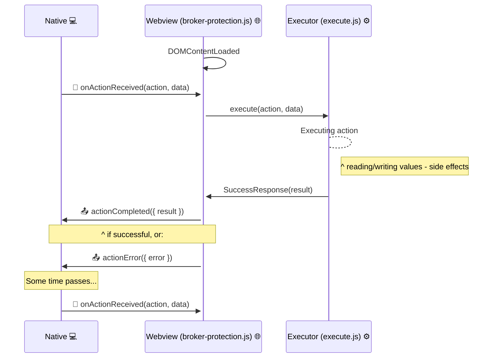

## Broker Protection

The following is a high-level description of how the Broker Protection actions are triggered by the native side. 



## User assist

For runs the user is watching, native can turn on in-page affordances and hand individual steps to the user. All of it is off unless native opts in, and page state resets on every load, so native re-sends these after each navigation.

| Message | Direction | Params | Effect |
|---------|-----------|--------|--------|
| `setAssistMode` | native → page | `{ enabled: boolean }` | While enabled, `click` actions show the agent cursor moving to their target, and `fillForm` actions fill as usual then visibly re-type each value (without dispatching extra events). |
| `userTurnStarted` | native → page | `{ kind: 'turnstile' \| 'recaptcha' \| 'managedChallenge' \| 'generic', tokenSelector: string \| null }` | Outlines the challenge widget with a "Your turn" badge and a "Waiting for you" pill, and holds retry attempts of the in-flight action until the turn ends. |
| `userTurnCompleted` | page → native | `{ kind }` | Sent once per turn when the challenge's token field (`tokenSelector`, or the provider's default) gets a value. |
| `userTurnEnded` | native → page | `{ reason }` | Clears the turn's affordances and releases held retries. |

Cloudflare managed challenges replace the whole page, so native detects when they're cleared rather than relying on `userTurnCompleted`.

## Error Handling

Use `PirError` for typed errors throughout the broker-protection feature:

```js
import { PirError } from './types.js';

// Creating errors
if (!element) {
    return PirError.create('could not find element');
}

// Checking for errors
if (PirError.isError(result)) {
    return createError(result.error.message);
}

// Element validation pattern
if ((isInputElement(element) && ['text', 'hidden'].includes(element.type)) || isTextAreaElement(element)) {
    element.value = token;
} else {
    return PirError.create('element is neither a text input nor textarea');
}
```

**Key principles:**
- Always bubble up errors to avoid silent failures
- Use specific error messages that identify the failing operation
- Check `PirError.isError()` before accessing result values
