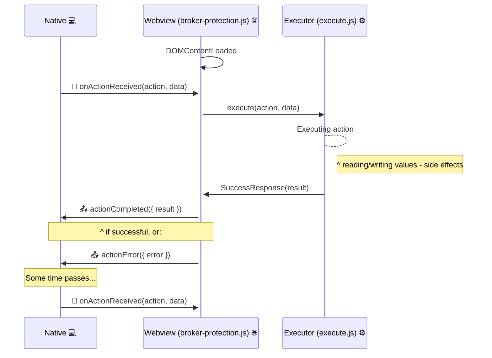

## Broker Protection

The following is a high-level description of how the Broker Protection actions are triggered by the native side. 



## User assist

### `userAssist` action

Hands a step to the user, such as solving a CAPTCHA, and resolves once the page shows it's done.

```json
{
  "actionType": "userAssist",
  "id": "solve-captcha",
  "step": "Searching for your record",
  "highlight": "#captcha-widget",
  "handOffAfterMs": 10000,
  "completeWhen": [{ "type": "element", "selector": "#optout-form input[name='cf-turnstile-response'][value]:not([value=''])" }]
}
```

- `completeWhen` takes the same items as an `expectation` action, and passes when such an action would succeed. An element item's `parent` must exist but isn't scrolled into view, since `completeWhen` is polled while the user works on the page.
- If `completeWhen` already passes, the action completes straight away. So when the page navigates during a `userAssist`, native can re-send the same action after load.
- Otherwise the page polls `completeWhen`. After `handOffAfterMs` (default 0) it outlines `highlight` (CSS or XPath) and sends `userTurnNeeded { actionID }`. Once `completeWhen` passes it clears the outline and responds `actionCompleted` with success.
- It isn't retried and has no timeout here; native owns timeouts and cancellation. A new `onActionReceived` cancels a pending `userAssist`, which then sends no response.
- An element expectation only checks that an element exists, so to wait for a token, match on its value. Hidden inputs reflect their value in the `value` attribute, so `[value]:not([value=''])` works for Turnstile's `cf-turnstile-response`.

On Apple, `userAssist` and the `visualizeActions` setting are only in the `brokerProtection.js` bundle. `contentScopeIsolated.js` still has broker protection for app versions that load it from there, but without them.

### `step`

Any action may carry a `step` label. Native uses it to show progress; the page ignores it.

### `visualizeActions` setting

When native sets `"settings": { "visualizeActions": "enabled" }` on `brokerProtection` (for runs the user is watching), `click` actions show the agent cursor moving to their target, and `fillForm` actions fill as usual then visibly re-type each value. The re-typing is drawn over the field, so the page never sees a partial value or extra events. Without it, the only thing drawn is a `userAssist` hand-off outline.

### Trying it without the native app

`npm run build` then `npm run serve`, and open http://localhost:3220/broker-protection/harness.html. The harness plays native's part in an opt-out against a fake people search site (`integration-test/test-pages/broker-protection/sites/people-search/`), so you can watch the presentation and do the hand-offs yourself. The integration tests use the same fake pages.

## Error Handling

Use `PirError` for typed errors throughout the broker-protection feature:

```js
import { PirError } from './types.js';

// Creating errors
if (!element) {
    return PirError.create('could not find element');
}

// Checking for errors
if (PirError.isError(result)) {
    return createError(result.error.message);
}

// Element validation pattern
if ((isInputElement(element) && ['text', 'hidden'].includes(element.type)) || isTextAreaElement(element)) {
    element.value = token;
} else {
    return PirError.create('element is neither a text input nor textarea');
}
```

**Key principles:**
- Always bubble up errors to avoid silent failures
- Use specific error messages that identify the failing operation
- Check `PirError.isError()` before accessing result values
